# Akelaty - أكلاتي

<p align="center">
  
</p>

<p align="center">
  <b>Akelaty (أكلاتي)</b> is a modern, feature-rich recipe discovery and food exploration mobile application built with <b>Flutter</b> and <b>Dart</b>. It empowers users to explore diverse culinary traditions, search for recipes with intelligent typo tolerance, view comprehensive step-by-step cooking guides, and save favorite dishes with real-time cloud synchronization.
</p>

<p align="center">
  
  
  
  
  
</p>

---

## 📱 App Screenshots

### Home & Favorites
<table>
  <tr>
    <td align="center" width="50%">
      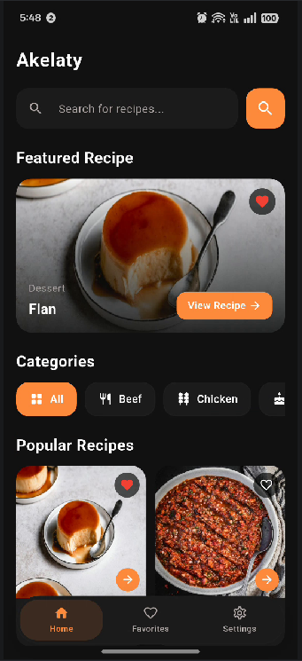
      <br />
      <sub><b>Home & Recipe Discovery</b></sub>
    </td>
    <td align="center" width="50%">
      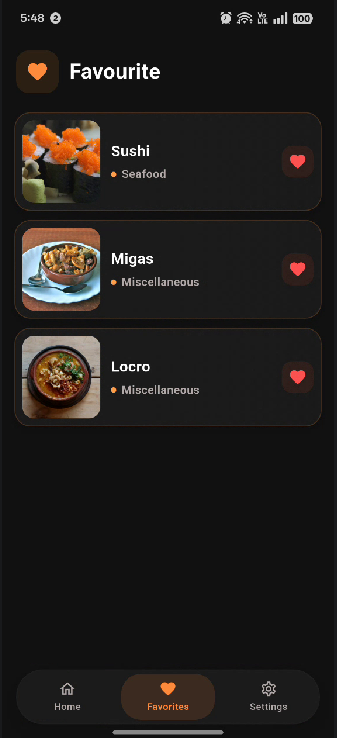
      <br />
      <sub><b>Saved Favorites</b></sub>
    </td>
  </tr>
</table>

### Recipe Details
<table>
  <tr>
    <td align="center" width="33%">
      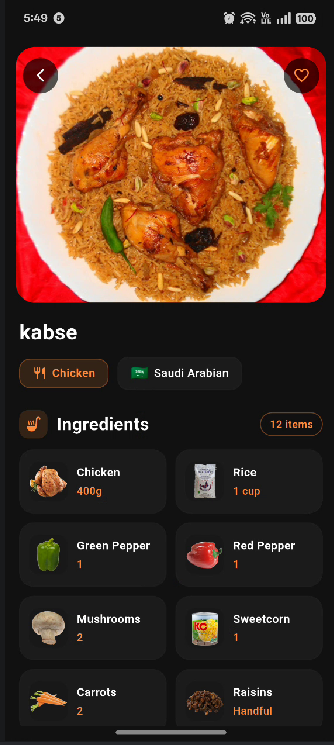
      <br />
      <sub><b>Overview & Badges</b></sub>
    </td>
    <td align="center" width="33%">
      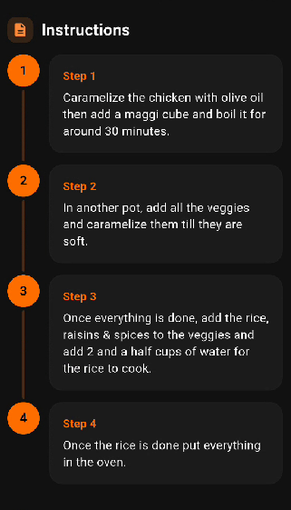
      <br />
      <sub><b>Ingredients & Measures</b></sub>
    </td>
    <td align="center" width="33%">
      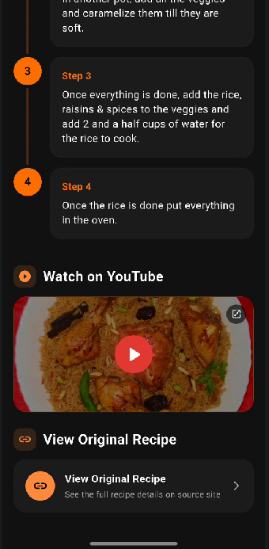
      <br />
      <sub><b>Instructions & Video Tutorial</b></sub>
    </td>
  </tr>
</table>

### Authentication
<table>
  <tr>
    <td align="center" width="33%">
      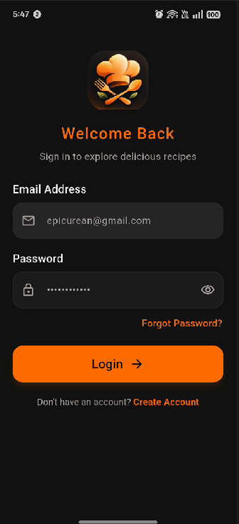
      <br />
      <sub><b>User Sign In</b></sub>
    </td>
    <td align="center" width="33%">
      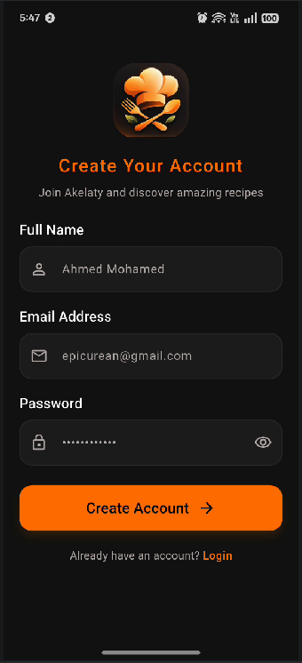
      <br />
      <sub><b>User Registration</b></sub>
    </td>
    <td align="center" width="33%">
      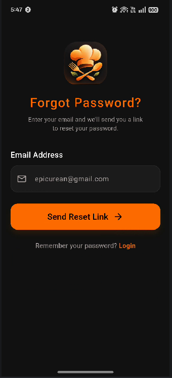
      <br />
      <sub><b>Password Recovery</b></sub>
    </td>
  </tr>
</table>

### Profile & Settings
<table>
  <tr>
    <td align="center" width="25%">
      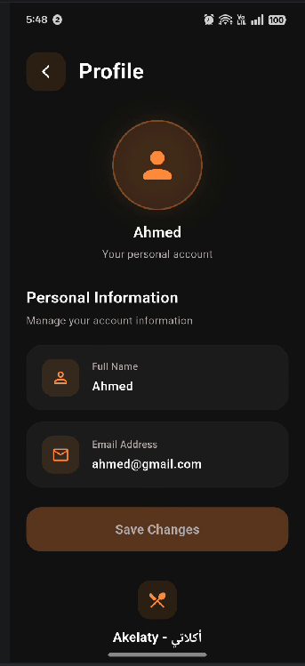
      <br />
      <sub><b>Profile Details</b></sub>
    </td>
    <td align="center" width="25%">
      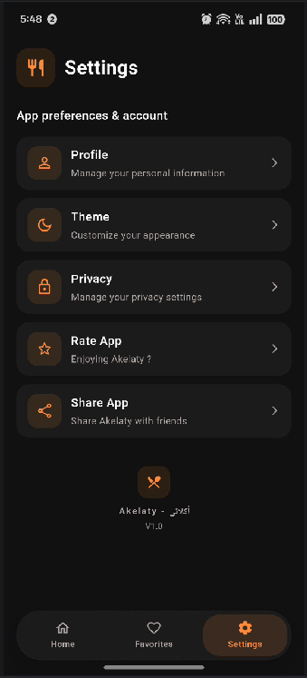
      <br />
      <sub><b>App Settings</b></sub>
    </td>
    <td align="center" width="25%">
      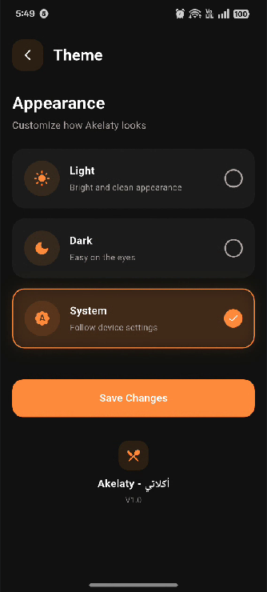
      <br />
      <sub><b>Theme Appearance</b></sub>
    </td>
    <td align="center" width="25%">
      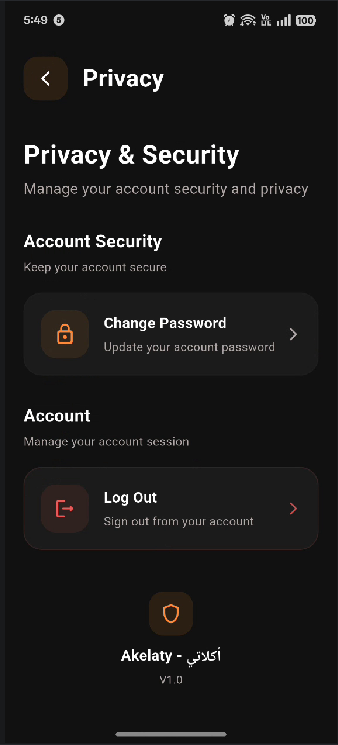
      <br />
      <sub><b>Privacy & Security</b></sub>
    </td>
  </tr>
</table>

---

## ✨ Features

- **Recipe Discovery & Browsing**: Explore a wide range of curated international meals with featured hero recipes and popular meal cards.
- **Category Filtering**: Quickly filter meals by dietary categories (Beef, Chicken, Dessert, Seafood, etc.).
- **Smart Typo-Tolerant Search**: Real-time recipe search with Levenshtein-distance fuzzy matching fallback, allowing users to find recipes even with spelling mistakes (e.g., matching "piza" or "chiken").
- **Rich Recipe Details**:
  - High-resolution dish imagery, category, and regional tags.
  - Interactive two-column ingredients grid with exact proportional measurements.
  - Formatted step-by-step preparation guide.
  - Direct links to YouTube video tutorials and original source websites via `url_launcher`.
- **Hybrid Favorites System**:
  - Save and remove recipes with instant local persistence (`SharedPreferences`).
  - Seamless two-way cloud synchronization with Cloud Firestore tied to the authenticated user's account.
- **Firebase Authentication**:
  - Email and password sign in and sign up.
  - Password recovery via email reset links.
  - Real-time profile state tracking and account logout.
- **Account & Profile Management**:
  - Update user display name synced directly with Cloud Firestore.
  - In-app password change requests and session management.
- **Appearance & Theme Customization**:
  - Full support for Light, Dark, and System Default themes.
  - Theme mode preference persisted across app restarts via `SharedPreferences`.
- **Responsive Layout**: Designed and scaled across diverse screen sizes and densities using `flutter_screenutil`.

---

## 🛠️ Technologies Used

- **Framework**: [Flutter](https://flutter.dev) (Dart SDK `^3.12.2`)
- **State Management**:
  - [Provider](https://pub.dev/packages/provider) (`^6.1.5+1`): App-wide reactive state management (`AuthProvider`, `MealProvider`, `ThemeProvider`).
  - `ValueNotifier`: Lightweight reactive state synchronization for favorites.
- **Networking & API**:
  - [Dio](https://pub.dev/packages/dio) (`^5.11.1`): HTTP client for fetching remote recipe data.
- **Backend & Cloud**:
  - [firebase_core](https://pub.dev/packages/firebase_core) (`^4.15.0`): Firebase app initialization.
  - [firebase_auth](https://pub.dev/packages/firebase_auth): User authentication and session management.
  - [cloud_firestore](https://pub.dev/packages/cloud_firestore): Cloud database for user documents and synchronized favorites.
- **Storage & Preferences**:
  - [shared_preferences](https://pub.dev/packages/shared_preferences): Local persistence for theme settings and cached favorites.
- **UI & Utilities**:
  - [flutter_screenutil](https://pub.dev/packages/flutter_screenutil) (`^5.9.3`): Adaptive screen sizing and typography scaling.
  - [url_launcher](https://pub.dev/packages/url_launcher) (`^6.3.3`): External deep linking to YouTube recipes and web sources.
  - [flutter_svg](https://pub.dev/packages/flutter_svg): Vector graphics rendering.
  - [introduction_screen](https://pub.dev/packages/introduction_screen) (`^5.0.1`): Onboarding walkthrough experience.

---

## 🌐 API & Data Source

Akelaty integrates with **[TheMealDB](https://www.themealdb.com/)** open recipe database to deliver detailed culinary information:

- **Meal Fetching**: Queries full meal lists (`search.php?s=`) on startup and caches them locally for performance.
- **Category Filtering**: Fetches category-specific meals using `filter.php?c={category}`.
- **Recipe Lookup**: Retrieves full recipe metadata, instructions, ingredient lists, and media links using `lookup.php?i={id}`.
- **Fuzzy Search Algorithm**: Includes an in-app Levenshtein distance matching algorithm that compares user query terms against cached meal names and categories to deliver typo-tolerant search results.

---

## 📁 Project Structure

```plaintext
lib/
├── api_service/              # Remote data source integrations
│   └── meal_api/             # TheMealDB Dio client & fuzzy search logic
├── core/                     # Application themes, constants, and utilities
│   └── theme/                # Light & dark theme definitions
├── models/                   # Data transfer objects and entity models
│   ├── fireStore_models/     # Firestore user model
│   └── meal_model/           # Recipe and ingredient data model
├── pages/                    # UI screens and modular widgets
│   ├── OnBoarding/           # App onboarding walkthrough
│   ├── auth/                 # Login, signup, forgot password, and auth gate
│   ├── favourite/            # Saved recipes view & FavouritesStore
│   ├── home/                 # Discovery page, category chips, recipe cards
│   ├── meal_details/         # Recipe overview, ingredients grid, steps, media
│   ├── navigation/           # Bottom navigation shell
│   ├── settings_pages/       # Profile, theme selector, privacy & security
│   └── splash/               # Splash screen and initial route handling
├── providers/                # Provider state managers
│   ├── auth_provider.dart    # Firebase authentication & profile handling
│   ├── meal_provider.dart    # Meal data retrieval & search state
│   └── theme_provider.dart   # Theme switching & preferences persistence
├── firebase_options.dart     # Auto-generated Firebase platform configuration
└── main.dart                 # Application entry point & provider declarations
```

---

## 🚀 Getting Started

### Prerequisites

- [Flutter SDK](https://docs.flutter.dev/get-started/install) (`>= 3.12.2`)
- [Android Studio](https://developer.android.com/studio) or [VS Code](https://code.visualstudio.com/) with Flutter extension
- An active Android device, emulator, or iOS simulator

### Installation

1. **Clone the repository**:
   ```bash
   git clone https://github.com/ahmedabbas06/Food_Explorer.git
   ```

2. **Navigate to the project root**:
   ```bash
   cd Food_Explorer
   ```

3. **Install project dependencies**:
   ```bash
   flutter pub get
   ```

4. **Run the application**:
   ```bash
   flutter run
   ```

> **Note**: Firebase configuration is integrated via `firebase_options.dart`. Ensure you have an active network connection for authentication and recipe fetching.

---

## 📦 Build Release APK

To generate a production release APK for Android devices:

```bash
flutter build apk --release
```

Upon successful compilation, the release APK can be found at:

```plaintext
build/app/outputs/flutter-apk/app-release.apk
```

---

## 🔮 Future Improvements

- [ ] **Multi-Language Support**: In-app localization with full Arabic and English language toggles.
- [ ] **Offline Recipe Caching**: Full offline caching of meal images and instructions for low-connectivity access.
- [ ] **Custom Meal Creation**: Allowing users to create, document, and store their own homemade recipes.
- [ ] **Nutritional Information**: Displaying calories and macronutrient breakdown for recipes.

---

## 👨‍💻 Author

**Ahmed Abbas**  
Flutter Developer | Computer Science Student  

- GitHub: [https://github.com/ahmedabbas06](https://github.com/ahmedabbas06)
- LinkedIn: [https://www.linkedin.com/in/ahmed-abdullah-abbas](https://www.linkedin.com/in/ahmed-abdullah-abbas)
